# Allods Survivors

A standalone autocast survival game with original Allods artwork, spells, equipment, enemy casters and terrain.

**Unofficial fan project.** Allods 2 / Rage of Mages II: Necromancer was developed by [Nival Interactive](https://www.gog.com/en/game/rage_of_mages_ii_necromancer). All rights to the original game and its artwork, characters, interface, audio, fonts and other assets belong to their original creators and respective rights holders. No ownership of those assets is claimed. This project is not affiliated with or endorsed by Nival Interactive or the original game's publishers.

The forest menu backdrop, gold panel frame and burgundy button are generated artwork. Menu text, class selection, stats and cooldowns remain live UI; character dolls, equipment and spell icons use original Allods assets. Base outfits are presentation only and grant no equipment or stats. Inventory and HUD paperdolls share the same composition: cloaks and wings behind the character, and boots beneath robe hems. In-game paperdolls, backpack rows, item cells, minimap and spell slots retain their original Allods image backdrops; vital and stat text uses plain backgrounds for readability.

Portrait screens and windows at most 900 CSS pixels wide automatically use a mobile layout that fills the screen. Full-screen touch steering is the default: hold on the battlefield to move in that direction, drag to steer, and release to stop. An optional translucent thumb joystick can be enabled in settings; it stays above the spell row, has a small dead zone, and resets when inventory, pause, or level-up opens. The mobile HUD keeps eight spell slots, backpack, pause and a left-hand settings gear; desktop controls return on wider landscape screens. Phone notch and home-indicator safe areas are respected. The gear button on the left opens controls and camera settings: choose thumb joystick or full-screen hold-and-drag steering, and set world zoom from 100% to 200%. Buttons and menus keep their size. Preferences are saved separately from progress and survive death or a new session.

The campaign uses native map regions from the [Allods2.eu map pack](https://allods2.eu/files/maps_all.zip): 202 suitable map files currently contribute bounded regions of at most 48 x 40 tiles. Choose a seeded 12-region journey or all 202 regions. Original terrain, heights, sparse trees/buildings and supported creature families are retained. Fight a guardian, enter its portal within 30 active seconds, then spend earned gold at camp. The spell pool contains 23 retained native spell identities; Wall of Earth is removed from spell choices, casting and item bonuses, including older saves. Self-buffs obey their displayed recast cooldown, so short effects can expire before the next cast. Spells use cooldowns only; mana, mana regeneration, mana affixes and mana-efficiency rewards are removed, including from older saves. **Continue saved run** restores the current region, build and pending rewards. See [the mechanics profile](docs/survivors-mechanics.md) for the map selection rules, formulas and tests.

Save files can be transferred between browser, mobile and desktop using **Export save** and **Import save** on the main menu. Select the exported JSON file and choose **Replace progress** to confirm. Import replaces the current inventory, gold and saved run; Cancel leaves them untouched. Invalid or oversized files are rejected. The Electron **Game > Import progress** menu remains available too.

Allods 2 reference used for this project: [Allods2.eu: About](https://www.allods2.eu/en/about/).

Built with workflows collected in [Regis](https://github.com/Sxela/regis), a combined skill developed from the findings of this project and related game adaptations.

## Screenshots

Captured from the current build using staged encounters and example builds. Character dolls remain dressed.

Level-up and camp cards show exact before/after stats, cooldown changes and estimated DPS. Improve hero stats or individual spells; every fifth level offers new spells, and five individual spell improvements unlock a free specialization with explicit trade-offs. Item spell-level bonuses remain part of the build. Current stats and the bestiary are available from the settings gear.

| Native-map combat | Native terrain and scenery |
| --- | --- |
| 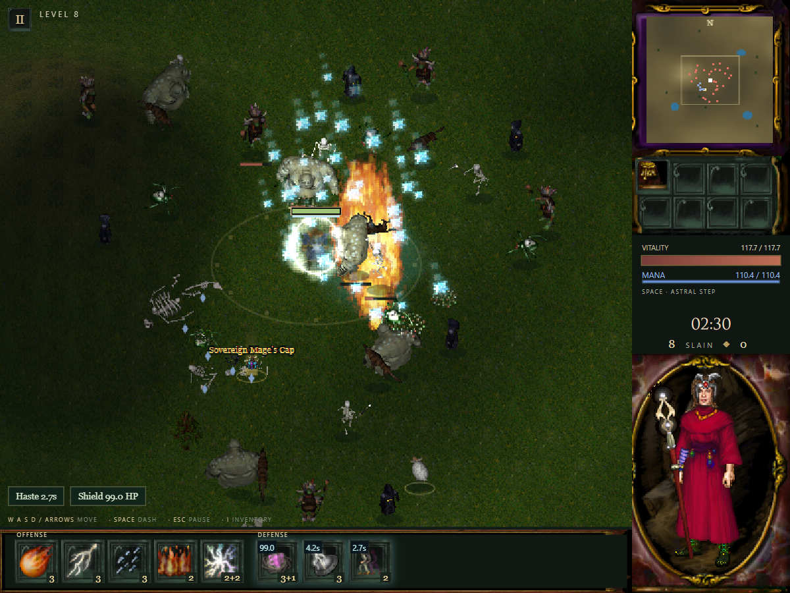 | 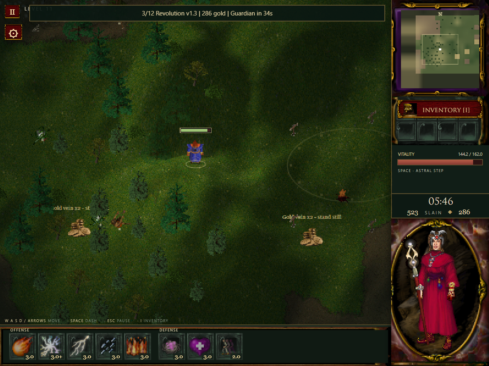 |
| **Guardian encounters** | **Equipment and the original character doll** |
| 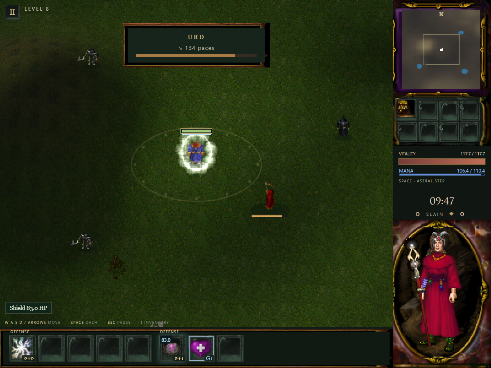 | 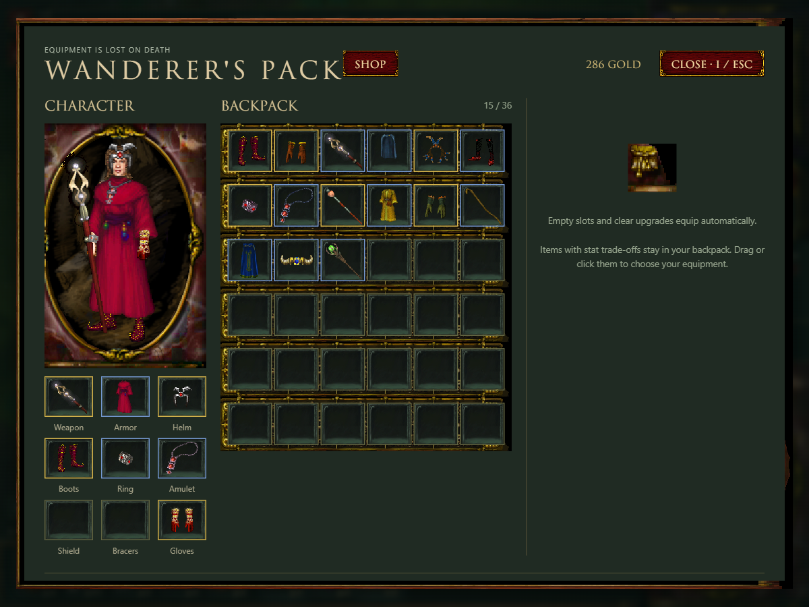 |
| **Level-up upgrades with exact stat and DPS changes** | **Spell specializations and their trade-offs** |
| 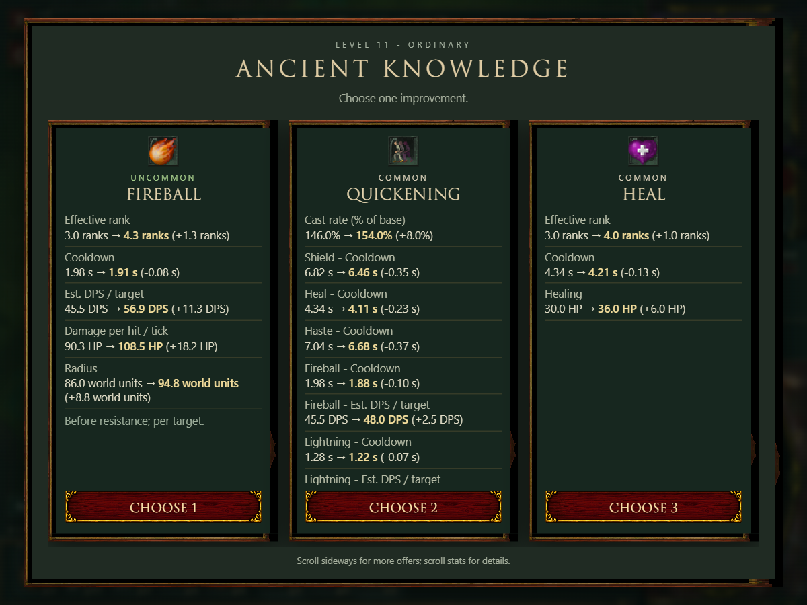 | 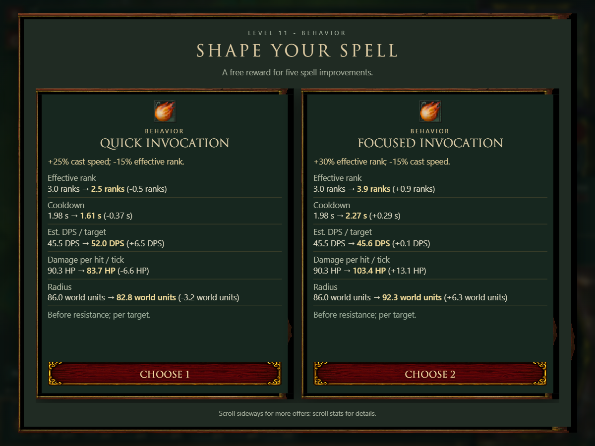 |
| **Safe-camp upgrades** | **Equipment shop inside the inventory** |
| 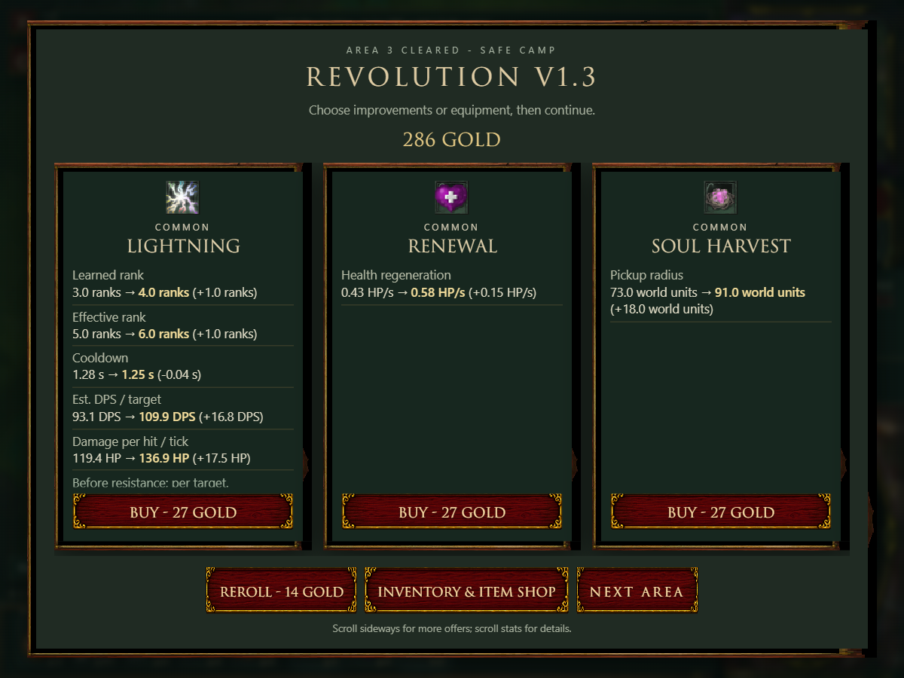 | 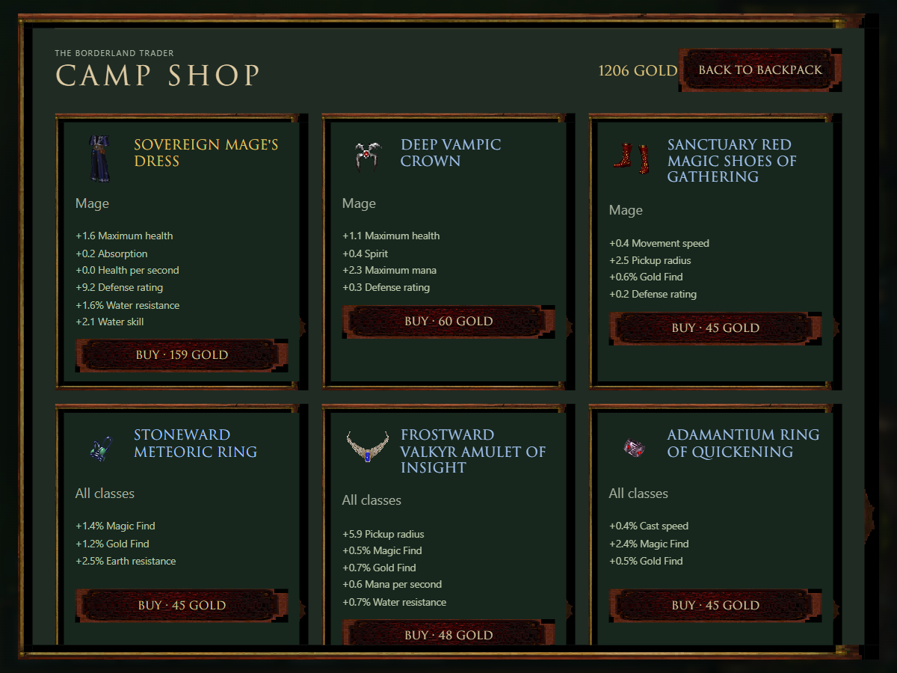 |
| **Side-by-side item comparisons** | **Current stats and contributing sources** |
| 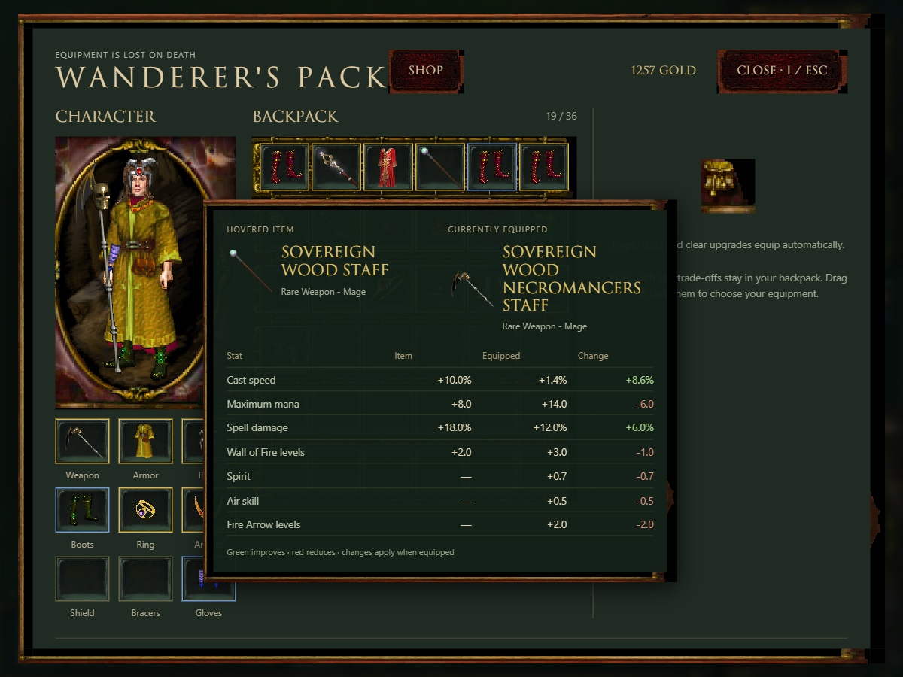 | 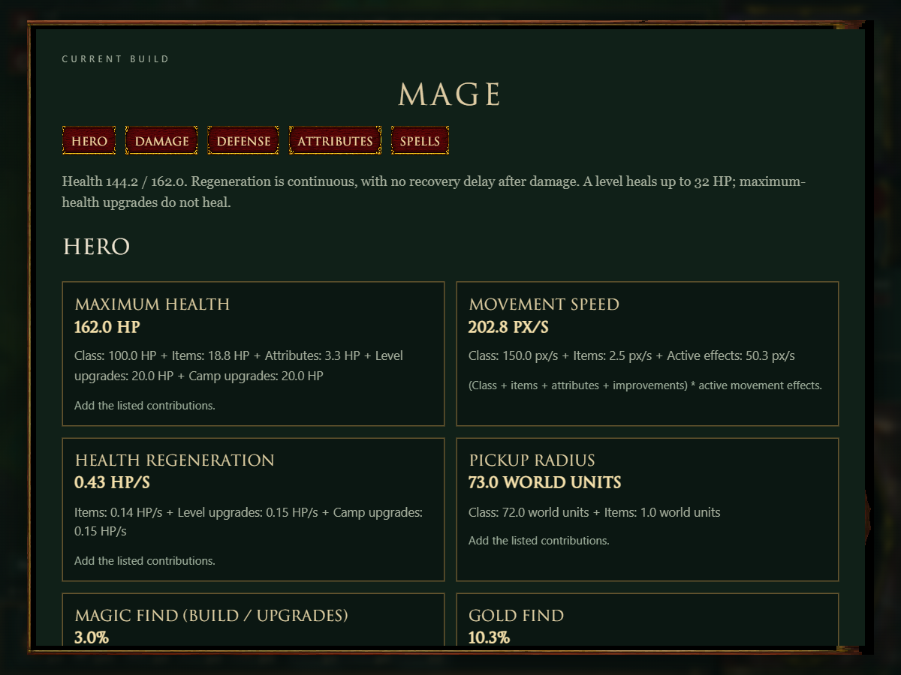 |

**Bestiary: original creatures, attack types and current encounter stats**

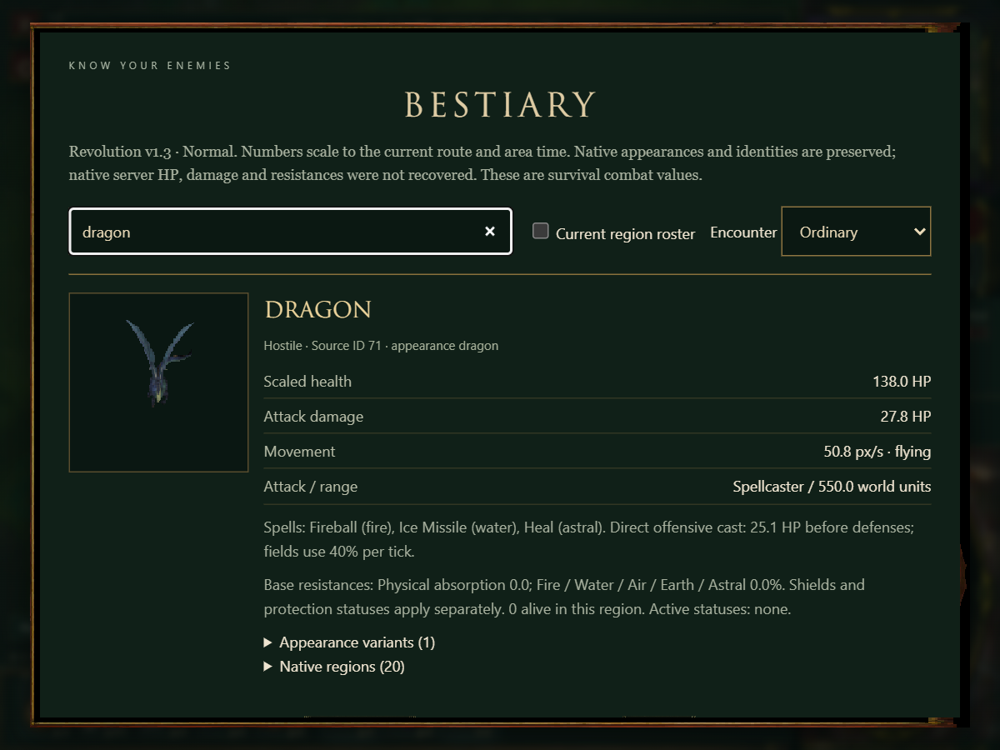

Move with WASD or the arrow keys. Spells cast automatically. Space dashes, I opens inventory, and Escape pauses. Defeat each guardian, extract, and finish the final camp after defeating Urd. Death resets progression. Compatible equipment fills empty slots and clear upgrades equip automatically; items with stat tradeoffs remain in the backpack.

## Building the Electron app

Build on Windows x64 with Node.js LTS and npm installed (Node.js 24 is used for development). Open a terminal in the repository root, where `package.json` is located. The first dependency install and packaging run need internet access to download Electron and build tools. The game assets are already included; no original Allods installation or asset extraction is required.

Install the exact dependencies from the lockfile:

```powershell
npm ci
```

Run the desktop app during development:

```powershell
npm run desktop
```

This stages the current game source and referenced assets, then launches Electron. Stop and rerun the command after changing source files; it does not start a watch process.

Build a portable Windows x64 executable:

```powershell
npm run desktop:dist
```

Distribute **`dist/Allods-Survivors-win-x64.exe`** as a single file. Players do not need Node.js, Electron, an installer, or the source repository.

For an unpacked desktop build instead:

```powershell
npm run desktop:pack
```

Run `dist/win-unpacked/Allods Survivors.exe`. Distributing this version requires the entire `dist/win-unpacked/` folder, including its supporting files.

Both packaging commands stage only the referenced runtime files and assets, then audit the packaged application. The audit report is written to `dist/asset-report.json`. To stage the game payload without launching or packaging Electron, run `npm run desktop:stage`.

## Browser version and tests

For the browser version, run `node survivors/launcher.cjs` or use `Start-Survivors-Browser.cmd` on Windows. The browser launcher serves the game on localhost.

Run the self-contained gameplay tests after installing dependencies:

```powershell
npm test
```

## GitHub Actions releases

The **Tests** workflow runs gameplay, release tooling and package-audit tests on Windows and Linux for pushes and pull requests, and checks runtime staging.

To publish binaries, open **Actions > Release binaries > Run workflow** in GitHub. Select the branch containing the release source and enter a version such as `1.2.3` or `1.2.3-beta.1` (a leading `v` is optional). The workflow validates the version, runs tests, then builds and audits Windows x64 and Linux x64 packages on their respective runners. Only when both builds pass does it create the `v<VERSION>` GitHub release at the selected source commit and upload:

- `Allods-Survivors-win-x64.exe`: portable Windows executable.
- `Allods-Survivors-linux-x64.AppImage`: portable Linux executable; run `chmod +x` on it before launching.
- `Allods-Survivors-linux-x64.tar.gz`: Linux app folder; extract it and run `allods-survivors` with the supporting files beside it.
- Per-platform asset audit reports and `SHA256SUMS.txt` checksums.

Prerelease versions create GitHub prereleases. Choose a new version for each release; an existing release is not overwritten. The workflow sets package versions only in the build job and creates no source commits. It uses the built-in GitHub token, with release write permission limited to the publishing job; no personal token is needed.

For a local Linux build, use Node.js LTS on Linux and run `npm ci`, then `npm run desktop:dist -- --linux`. To build an unpacked Linux folder, use `npm run desktop:pack -- --linux`.

## Project layout

- `survivors/`: editable game source and selected runtime assets.
- `desktop/`: sandboxed Electron window and local asset protocol.
- `tools/`: runtime staging, desktop build and package audit.
- `tests/`: self-contained gameplay and rendering-model tests.
- `PUBLIC-EXPORT-MANIFEST.json`: relative paths and hashes from the latest source export.

Game data is already prepared; an original installation or extraction tools are not needed to run or build this tree. Survival balance and reconstructed rendering behavior are project-specific. Allods artwork, audio and font retain their original ownership; this repository does not assign a new license to those assets.

Balance diagnostics: run `npm run test:balance` for a five-seed, three-class/difficulty/policy matrix. See [balance testing](docs/balance-testing.md) for focused runs, telemetry and limits. Simulation results are separate from correctness tests and human playtesting.

Upgrade and camp cards show their rolled HP, speed, spell rank and potency changes as before/after values. Hover, keyboard-focus or tap a bottom-row spell for current values, equipment levels and live cooldown/ward state. The left gear opens **Current stats & spells** (with contributing sources) and a searchable **Bestiary**, including current-region creatures, source art, encounter scaling, attacks and resistances. Item bonuses such as **+3 Wall of Fire** still grant an autocast without learning the spell or enabling its individual upgrades.

Waves begin with 25-40 enemies on Normal, grow by five every two waves within an area (up to +25), and gain up to 20 more across route progress. Reinforcements use the current camera perimeter and retain queued spawns; extraction increases their frequency. Difficulty scales density and timing.

Fresh Mage campaigns start with Fire Arrow and Fireball, giving focused and area attacks immediately. Existing saved loadouts are restored as saved.

## Technical validation and asset loading

Required artwork reports download/decode progress and offers Retry on failure. Region actors and scenery load before play advances; old scene resources are released, and floor-item thumbnails use a bounded on-demand cache. Original lossless atlas pixels, combat rules and equipment automation are preserved.

Install browser test prerequisites separately from building the desktop app:

```sh
npm ci
npx playwright install --with-deps chromium webkit
npm test
npm run audit:assets
```

`npm test` runs unit rules and portable browser checks, including desktop/touch loading recovery, save/continue, menu fit and actual sprite grounding. `npm run test:unit` runs the unit suite alone. CI installs its browser binaries explicitly. For an installed-Chrome-only local run, set `ALLODS_BROWSER_CHANNEL=chrome` and `ALLODS_BROWSERS=chromium`; that narrower run does not validate WebKit or real phones.

See [asset parity](docs/asset-parity.md) for the role audit and light/dark previews (`npm run audit:assets:preview`), and [performance playtesting](docs/performance-playtest.md) for throttled cold/warm measurements (`npm run test:performance`). Reports stay in `.build/`. Production-style local serving uses `node survivors/launcher.cjs --production --no-open` with gzip and conditional caching; deployed hosting still needs its own validation.
